<div align="center">

# Atlantis Native

**Return to Atlantis, on today's machines.**

A native port of *Atlantis: The Lost Tales* (Cryo Interactive, 1997),
*Atlantis II* (1999), *Atlantis III: The New World* (2001), *Atlantis
Evolution* (2004) and *The Secrets of Atlantis: The Sacred Legacy* (2006),
written in Rust, for Windows, macOS, Linux and your browser.

[](https://github.com/ripleyXLR8/atlantis-native/actions/workflows/build.yml)
[](https://github.com/ripleyXLR8/atlantis-native/releases/latest)
[](LICENSE)


[](https://buymeacoffee.com/ripleyxlr8)

**[▶ Play in your browser](https://ripleyxlr8.github.io/atlantis-native/)** (your own copy of the game needed)

[繁體中文](README.zh-TW.md) · [简体中文](README.zh-CN.md) · [Download](#download) · [Quick start](#quick-start) · [Features](#features) · [Controls](#controls) · [Player's guide](docs/GUIDE.md) · [Technical notes](docs/TECHNICAL.md)

</div>

---

Seth, the queen's new guard, wakes up in Atlantis just as Queen Rhea
disappears. Atlantis Native brings back the whole adventure: the 360°
panoramas, the cinematics, the talking heads with their 3D mouths in time
with the voices, the seventeen puzzles and the end credits. It plays from
the first screen to the last.

Its sequel *Atlantis II* (*Beyond Atlantis*, 1999) plays from start to
end too, on Windows, macOS, Linux and in the browser: Tibet, Ireland,
China, Yucatán and Xibalba, Shamballa and Atlantis, with every puzzle (see
[Atlantis II](docs/GUIDE.md#atlantis-ii)).

*Atlantis III: The New World* (2001) plays from start to end as well, on
the desktop and in the browser: from the Hoggar desert through the Land
of the Dead and the other worlds to the credits, with its dialogs,
menus, saves and every puzzle. Three editions are known: GOG.com's, in
English, French, German and Spanish, the French retail CD (2001, three
CDs) and the Italian *Atlantis Collection* DVD (2014) (see
[Atlantis III](docs/GUIDE.md#atlantis-iii)). It has been
checked mostly by automated replays against the original's code and by
the developer's own play, not yet by many players: reports are welcome.

*Atlantis Evolution* (2004) plays from start to end in GOG.com's
edition, in its five languages, from the splash screens and the main
menu through the whole story to the end, with its dialogs, inventory,
documents, saves and puzzles, its videos and sounds decoded as the
original decodes them. GOG.com does not sell the 2004 program: its
edition is a 2012 version of the game on the Tetraedge Engine, not on
Cryo's engine, so Atlantis Native has a new engine for it, drawn by the
graphics card with OpenGL (or WebGL 2 in the browser), or by the
processor. It has been checked by automated replays of the whole story
against the original's scripts and by the developer's own play (see
[Atlantis Evolution](docs/GUIDE.md#atlantis-evolution)).

**Preview:** the original 2004 CD program of *Atlantis Evolution*
(The Adventure Company's CD, English; Cryo's own engine, grown from
*Atlantis III*'s), played by the *Atlantis III* engine. It is in the game
library as *Atlantis Evolution (2004), CD, English*, beside GOG.com's
edition, on the desktop and in the browser: its logos, start page,
menus, saves, panoramas, chapter scripts, dialogs, inventory, music,
Bink films, the ship's pitching and its eight mini-games run, each
traced to the original's code and checked piece by piece by automated
tests. It has not yet been played through from start to end: reports
are welcome (see [The 2004 CD](docs/GUIDE.md#the-2004-cd-in-progress)).
The Italian *Atlantis Collection* DVD (2014) installs the same program
in Italian, *Atlantis Evolution (2004), Atlantis Collection, Italian*;
its installer leaves out the second CD's places, films and music, which
the English CD's installation provides (see
[The Italian Atlantis Collection](docs/GUIDE.md#the-italian-atlantis-collection-2004-program)).

*The Secrets of Atlantis: The Sacred Legacy* (*Atlantis V*, Nobilis,
2006), the last game of Cryo's *Atlantis III* engine, plays from start
to end from its French DVD (*L'Héritage sacré*), its international
DVD (English, German, Italian, Spanish) and its North-American CDs
(*The Secrets of Atlantis*, The Adventure Company, 2007, English) on the
desktop and in the browser: its drive, its files, its image or its
installation, in the game library as *The Secrets of Atlantis :
L'Héritage sacré (2006), DVD, French*, one entry per language, *The
Secrets of Atlantis: The Sacred Legacy (2006), DVD, German*, or *The
Secrets of Atlantis (2007), 3 CDs, English*; the Italian *Atlantis
Collection* DVD (2014) from its installed folder, as *The Secrets of
Atlantis (2014), Italian Atlantis Collection, installed, Italian*; on the desktop the DVD (or the three CDs, one after the other) can be copied to the computer once
(**Copy to this computer** in the game library), so that it plays from
the hard disk. The DVD's own Lua 5.0 scripts (compiled on the French
DVD, source on the international one) run as they are; the nine
chapters, the twenty puzzles, the dialogs, the inventory, the saves, the
deaths and the credits are checked by an automated walkthrough of the
whole story. What is missing (two fonts when Windows' own are not installed) is listed in
[The Secrets of Atlantis](docs/GUIDE.md#the-secrets-of-atlantis).

It is the original game, **pixel for pixel and sample for sample**: the
engine is a translation of the Atlantis engine written for
[ScummVM](https://www.scummvm.org/)'s CryOmni3D engine, itself rebuilt by
reverse engineering the original executable. Each behaviour is traced to an
address in the original code. On top of that come optional fixes of the
original's bugs and an optional HD mode.

## Screenshots

<p align="center">
  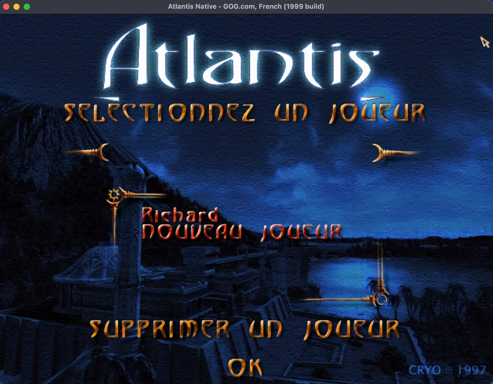
  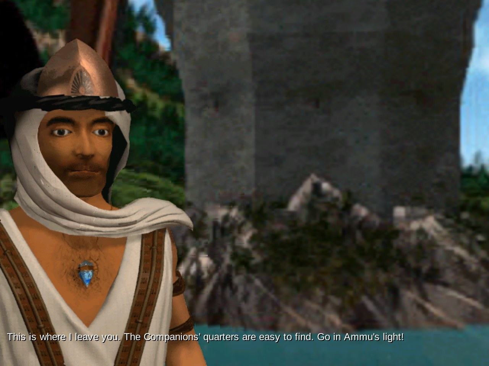
</p>

<p align="center">
  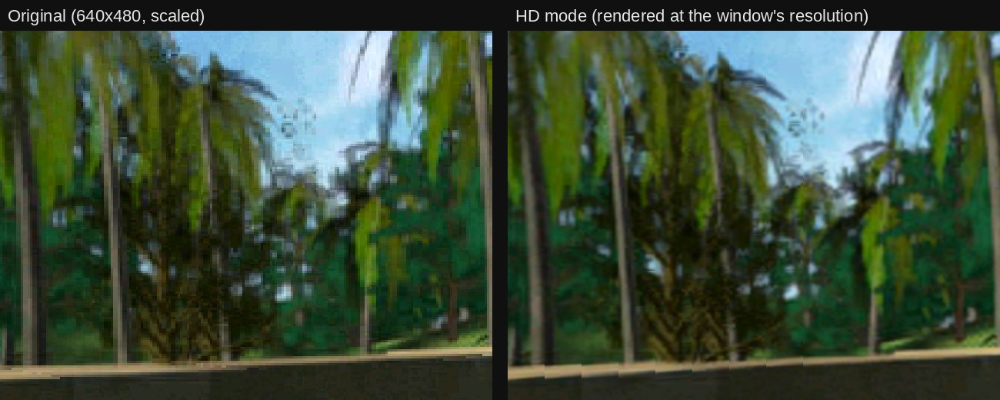
</p>

<p align="center">
  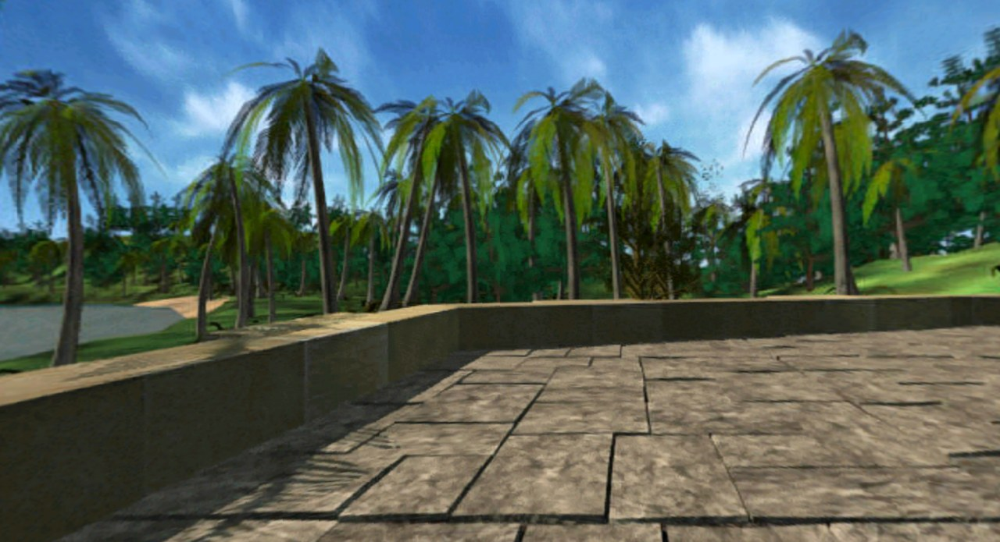
  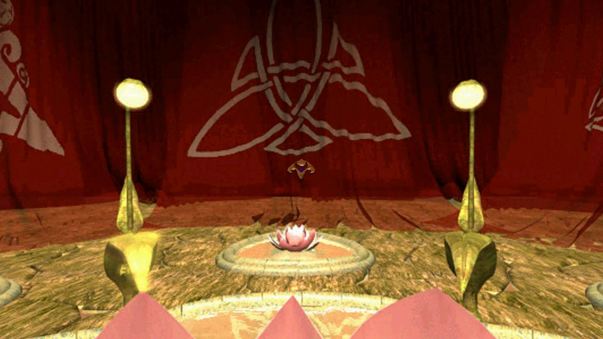
</p>

<p align="center">
  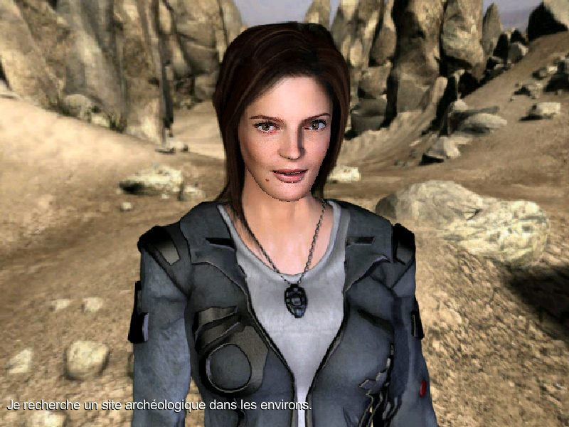
  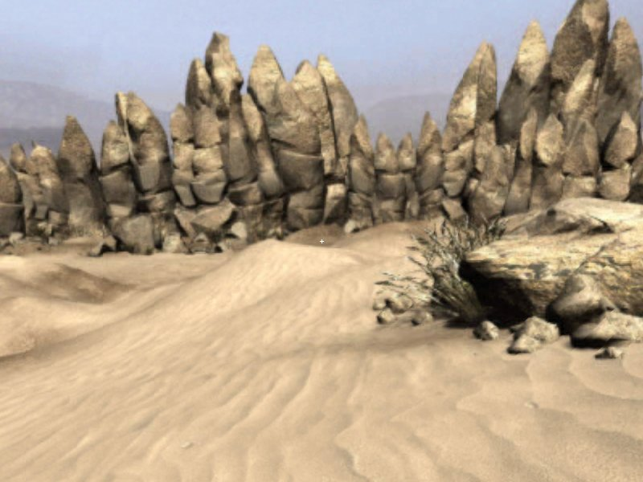
</p>

<p align="center">
  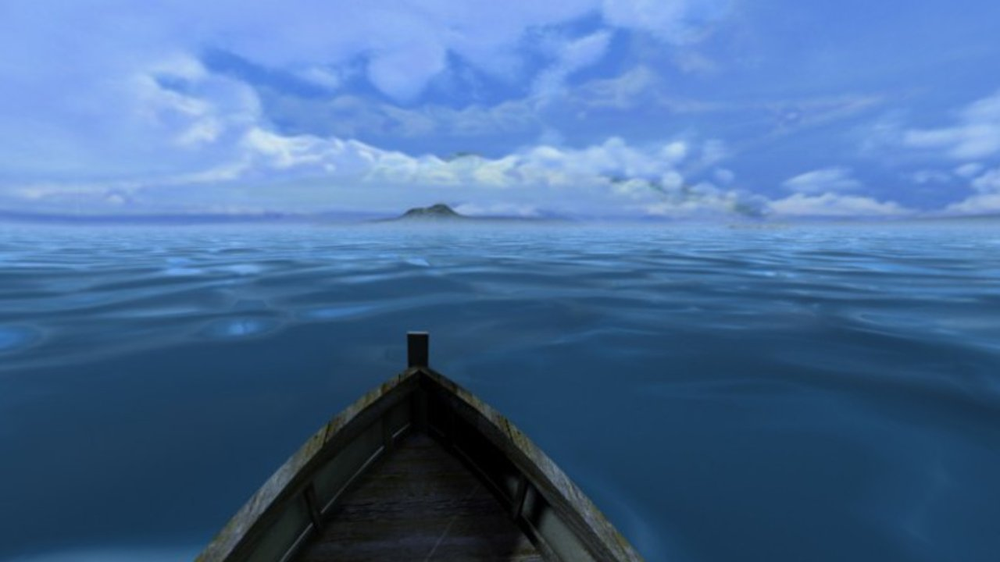
  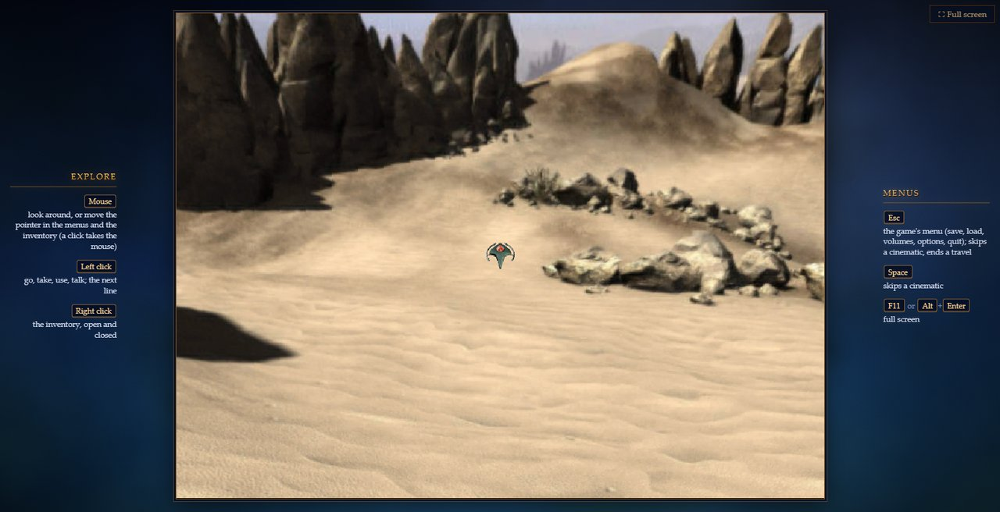
</p>

<p align="center">
  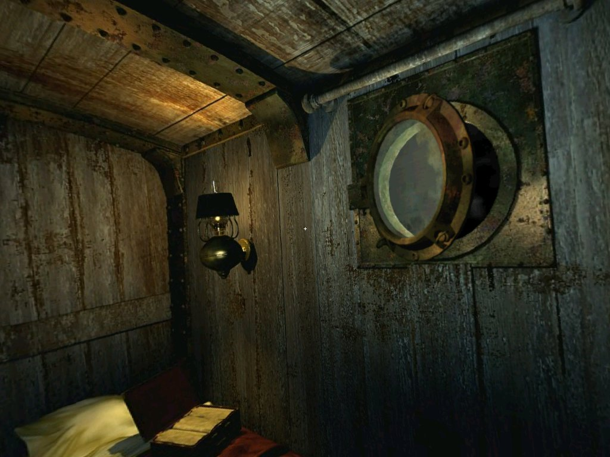
  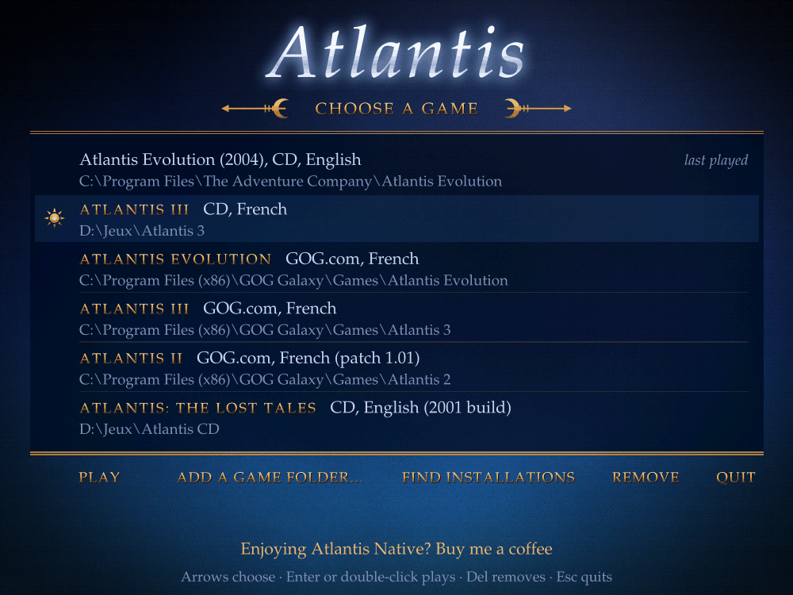
</p>

<sub>Left to right, top to bottom: the first game's player screen
(macOS, HD mode); a dialog with its 3D talking head drawn at the
window's resolution; the same view in the original's 640x480 and in the
HD mode; widescreen; *Atlantis II*'s Shamballa in the HD mode,
widescreen; a dialog of *Atlantis III* in the Hoggar (GOG.com's French
edition, 800 x 600); the Hoggar on *Atlantis III*'s French CD; *Atlantis
Evolution*, GOG.com's edition, at sea; the web version in Edge,
*Atlantis III*'s French CD read from its ISO images; the cabin of the
first scene on *Atlantis Evolution*'s 2004 CD (a preview); the game
library. The games' pictures and text are © Microids (the first three:
Cryo Interactive Entertainment), shown here to illustrate the engine;
Atlantis Native contains none of them.</sub>

## Features

- 🖥️ **Windows (x64 and ARM), macOS (Apple Silicon and Intel), Linux and the web**: one engine, the
  same game everywhere, even in a browser tab.
- 🎯 **Faithful**: the scripts, dialogs, music, 3D heads and puzzles run the
  original's own logic. The heads are drawn with the original's arithmetic,
  so the pixels match on every platform.
- ✨ **HD mode** (optional): the panoramas and 3D heads rendered at your
  window's resolution, sharp subtitles, and the interface art upscaled with
  xBR. With **Widescreen** on, the panorama fills the whole of a wide
  window, the projection carried on past the original's edges; beside
  the videos, black bars, the frame's edges blurred, the frame zoomed to
  the width (easing in and out of a move), or (for the moves) the
  panoramas of the places left and reached (up to a 2.4:1 picture, black
  beyond on wider screens).
- 🐞 **Bug fixes** (optional): seamless music loops, talking-head overlays
  drawn correctly, and other fixes of the original's bugs, each with its
  own switch (F10, "Choose the bug fixes...", which lists those of the
  edition played and what each one changes). One switch turns them all off
  for the game exactly as it shipped.
- 💾 **Your saves, compatible**: the game saves at every chapter, in the
  original's own file format. An existing installation's players and
  checkpoints are taken over on the first start.
- ⚙️ **Options menu** (F10, or O): graphics, HD settings and enhancements,
  changed at once while you play.
- 📚 **Game library**: several editions (GOG.com, CD, DVD, disc
  images...) of the five games in one list, to choose the one to play at
  start-up or switch from F10.
- 🏜️ **Atlantis III**: GOG.com's edition in English, French, German or
  Spanish, the French retail CD and the Italian *Atlantis Collection*'s
  installed game, whole, with the original's own menus
  and options (640 x 480, 800 x 600 or 1024 x 768, 16 or 32 bits; 32 by
  default, a bug fix), its saves kept apart from the game's folder, F12
  screenshots; on the desktop and in the browser.
- 🌊 **Atlantis Evolution**: GOG.com's edition in English, French,
  German, Italian and Spanish, its interface laid out on any window size
  as the original lays it out, full screen or windowed; Escape or Space
  skips a film (a bug fix: the original has only its skip button); on
  the desktop and in the browser. Its original 2004 CD program is in the game library
  too, as a preview, with the Italian *Atlantis Collection* DVD's
  (2014; the second CD's files taken from the English CD).
- 🏛️ **The Secrets of Atlantis**: the French and international DVDs
  (2006) and the North-American CDs (2007), read from the discs, their
  files, their images or the installation, nothing unpacked; the
  Italian *Atlantis Collection* DVD (2014) from its installation; its
  own scripts, menus and saves; full screen or windowed (F11); on the
  desktop (where the DVD can be copied to the computer once) and in the
  browser.
- 🌐 **In the browser**: the five games, read from your own folder; the
  CD editions of the first three and the DVD of *The Secrets of
  Atlantis* also from their disc images (`.iso`, `.bin`, `.img`, `.mdf`,
  `.nrg`), a part at a time.
- 🪟 **A modern window**: resizable, the picture kept in its 4:3
  proportions, the mouse captured while you look around; full screen at
  a key, and on the desktop kept for the next start (F10, "Start in full
  screen").

## Download

The [latest release](https://github.com/ripleyXLR8/atlantis-native/releases/latest)
holds the builds of the current version; the
[nightly release](https://github.com/ripleyXLR8/atlantis-native/releases/tag/nightly)
those of the latest commit:

| System | File |
|---|---|
| Windows 10 and later, 64-bit | `atlantis-native-windows-x64.zip` |
| Windows 11 on ARM (Snapdragon PCs, Surface) | `atlantis-native-windows-arm64.zip` |
| macOS 11 and later, Apple Silicon | `atlantis-native-macos-arm64.dmg` |
| macOS 11 and later, Intel | `atlantis-native-macos-x64.dmg` |
| Linux x86-64 (glibc 2.35+, ALSA) | `atlantis-native-linux-x64.tar.gz` |
| Linux 64-bit ARM, such as a Raspberry Pi 4 or 5 (glibc 2.35+, ALSA) | `atlantis-native-linux-arm64.tar.gz` |
| Handhelds with [PortMaster](https://portmaster.games/) (64-bit ARM: R36S, RG35XX, RGB30 and the like; Batocera, ROCKNIX, ArkOS, muOS, Knulli), the first game only | `atlantis-native-portmaster.zip` |
| Web (a static site to serve over HTTP; on the nightly release) | `atlantis-native-web.zip` |

The web version of the latest commit is also online:
**https://ripleyxlr8.github.io/atlantis-native/**, for the five games
(tried in Edge, a Chromium browser, and the four first in Firefox,
Atlantis II in Chrome too; not yet in Safari). Pick your game folder there: its files
are read inside your browser, a part at a time (the CD images too, and
Atlantis II's and III's cinematics), and never sent anywhere; the saves
stay in that browser. For the CD editions of Atlantis I, II and III, the
folder may hold the CD images (`.iso`, `.bin`, `.img`, `.mdf`, `.nrg`)
in place of copies of the discs, and *The Secrets of Atlantis* its DVD
image or copies of its three CDs (see [The web version](docs/GUIDE.md#the-web-version)).

> **Windows:** the program is not code-signed (a certificate costs money
> each year), so Windows SmartScreen may warn that it "protected your PC"
> the first time. Click **More info**, then **Run anyway**. It opens
> normally from then on. Download Atlantis Native only from its
> [releases page](https://github.com/ripleyXLR8/atlantis-native/releases):
> the builds there are made by this repository's public workflow.

> **macOS:** the app is signed ad hoc but not notarised by Apple (that
> needs a paid Apple Developer account), so macOS blocks it the first
> time. Since macOS 15 a right-click is not enough:
>
> 1. Open **Atlantis Native** once (macOS says it cannot verify it).
> 2. Go to **System Settings → Privacy & Security** and click
>    **Open Anyway** next to the message about Atlantis Native.
> 3. Confirm with **Open**. It opens normally from then on.
>
> Or, in the Terminal:
> `xattr -dr com.apple.quarantine "/Applications/Atlantis Native.app"`

> **Portable mode:** put an empty file named `portable.txt` (or a folder
> named `data`) next to the program (on macOS, next to `Atlantis
> Native.app`) and the saves, settings, game library and log go in that
> `data` folder instead of your user folder: deleting the program's
> folder then removes everything. `--data-dir <folder>` chooses another
> folder for one run, and `--help` lists every option (see [where the
> saves live](docs/GUIDE.md#players-checkpoints-and-settings)).

> **PortMaster:** unzip `atlantis-native-portmaster.zip` into the
> device's `ports` folder (it holds `Atlantis Native.sh` and the
> `atlantisnative` folder), then copy your game's files (the folder with
> `atlantis.exe` and `BIGCD1.BIG` … `BIGCD4.BIG`) into
> `ports/atlantisnative/gamedata/`, and restart the front end so it lists
> the port. The zip can instead be put, unopened, in PortMaster's
> `autoinstall` folder for PortMaster to install. The gamepad is the
> mouse, an on-screen keyboard types the names; the controls are in the
> port's `atlantisnative/atlantisnative.md`. It needs glibc 2.31 or newer
> and the system's SDL2, as PortMaster's firmwares have.

## You need the game

Atlantis Native contains **no game data**. Bring your own copy:

| Release | Languages | What to point it at |
|---|---|---|
| CD (2001 build) | English | the folder with `atlantis.exe` and `BIGCD1.BIG` … `BIGCD4.BIG` |
| CD, retail release (May 1997 build) | English | the folder with `atlantis.exe` and `BIGCD1.BIG` … `BIGCD4.BIG` |
| CD, US retail release (Interplay, August 1997 build, 4 CDs) | English | the folder with `atlantis.exe` and `BIGCD1.BIG` … `BIGCD4.BIG`, or the four disc images |
| CD, retail release (August 1997 build, 4 CDs) | French | the folder with `atlantis.exe` and `BIGCD1.BIG` … `BIGCD4.BIG` |
| CD, retail release, first pressing (May 1997 build, 4 CDs) | French | the folder with `atlantis.exe` and `BIGCD1.BIG` … `BIGCD4.BIG` |
| CD, retail release (August 1997 build, 4 CDs) | German | the folder with `atlantis.exe` and `BIGCD1.BIG` … `BIGCD4.BIG` |
| CD, retail release, first pressing (May 1997 build, 4 CDs) | German | the folder with `atlantis.exe` and `BIGCD1.BIG` … `BIGCD4.BIG`, or the four disc images |
| CD, retail release (June 1997 build, 4 CDs) | Dutch | the folder with `atlantis.exe` and `BIGCD1.BIG` … `BIGCD4.BIG` |
| CD, retail release (June 1997 build, 4 CDs) | Swedish | the folder with `atlantis.exe` and `BIGCD1.BIG` … `BIGCD4.BIG` |
| CD, retail release (August 1997 build, 4 CDs) | Spanish | the folder with `atlantis.exe` and `BIGCD1.BIG` … `BIGCD4.BIG` |
| CD, retail release (July 1997 build, 4 CDs) | Italian | the folder with `atlantis.exe` and `BIGCD1.BIG` … `BIGCD4.BIG` |
| CD, Czech release (Bohemia Interactive, 2000; also GAME4U Speciál 2, 2001; 4 CDs; Cryo's 1999 patch 1.01 program) | Czech subtitles and menus, English voices | the folder with `atlantis.exe` and `BIGCD1.BIG` … `BIGCD4.BIG`, or the four disc images |
| CD, Brazilian release (*Atlantis: A Lenda Perdida*, MSD Multimídia, 1997, 4 CDs; December 1997 build) | Brazilian Portuguese voices, subtitles and menus | the folder with `atlantis.exe` and `BIGCD1.BIG` … `BIGCD4.BIG`, or the four disc images |
| CD with Cryo's patch 1.01 (`AT1CDINT.EXE`, 1999 build) | English, French, German, Dutch, Swedish, Spanish or Italian CD (French interface) | the folder with the patched `atlantis.exe` and `BIGCD1.BIG` … `BIGCD4.BIG` |
| [GOG.com](https://www.gog.com/) | English, French, German, Spanish, Italian | the installation folder |
| *Atlantis Collection*, Italian DVD compilation (2014; shown as *CD, patch 1.01, Italian (1999 build)*, its program being Cryo's patch 1.01 with Italian strings) | Italian | the folder its installer creates for *Atlantis: Segreti di un Mondo Perduto* |
| CD, Traditional Chinese release (1998 build, 4 CDs) | Traditional Chinese subtitles and menus, English voices | the folder with `atlantis.exe` and the four `BIGCD` archives, or the four disc images |
| CD, Simplified Chinese release (1999 build, 4 CDs) | Simplified Chinese subtitles (Traditional Chinese menus, as shipped), English voices | the folder with `atlantis.exe` and the four `BIGCD` archives, or the four disc images |
| Cryo's DVD-ROM (1998 build, one double-sided DVD) | English, French, German, Dutch (side A); Spanish, Italian, Swedish, Japanese (side B: Japanese or English subtitles, English menus and voices); each language its own edition | the DVD drive, a copy of a side (the folder holding `FACE_A` or `FACE_B`), or the images of the sides (`.iso`) in one folder |
| Perfect Edition (Tgames' 2018 package of the DVD's English version) | English | the installation folder |

Each build plays as it shipped: the May 1997 English, French and German
CDs and the Dutch and Swedish CDs, for one, draw their subtitles in their own 8x8 pixel font (see [Game builds](docs/TECHNICAL.md#game-builds)).
The Czech CD's subtitles are read in the Central European code page, as
on the Czech Windows it was sold for (`č`, `ř`, `ů` and the other Czech
letters, not the Western letters a Western Windows shows there); its
player screen keeps the French `NOUVEAU JOUEUR` row of the program it
ships.
The Brazilian CD has a program of its own (December 1997): its menus
draw the Portuguese letters of its own fonts at its own widths, and its
name entry, as the original's, takes letters up to `§` only, so a typed
`ã` or `ç` is left out of the name. The only public dump known (Internet
Archive) has unreadable sectors on disc 2; a few films and one panorama
play damaged from it.
The May 1997 German CD's program also answers four keys its developers
left in (`T`, `R`, `F1`, `F3`: a panel of the engine's variables, and
others); Atlantis Native does not reproduce them.
The Chinese CDs' subtitles are drawn with your own Windows `mingliu.ttc`
(Traditional) or `simsun.ttc` (Simplified) when you put it in the game
folder, else with the bundled Noto Serif TC or SC.
The DVD's Dutch and Swedish subtitles show, as on the DVD, punctuation
signs in place of their accented letters (their texts are the CDs', which
the DVD's program reads as Windows text); a bug fix of the options menu
shows the letters.
The DVD's Japanese subtitles are drawn with MS PGothic when you have
`msgothic.ttc` (in the game folder, or among your system's fonts, as on any
Japanese Windows), else with the bundled Noto Sans JP; its SUBTITLES
option switches between Japanese, English and none. The Japanese version
starts by looking for two logo films the DVD does not hold: as on the DVD,
two "file not found" boxes show (OK closes them), unless the bug fix of the
options menu skips them.

For *Atlantis II*:

| Release | Languages | What to point it at |
|---|---|---|
| CD (1999, version 1.00) | French | the folder of the installed game (with `atlantis2.exe`), the images of its four CDs (or copies of the CDs) in it or in a folder inside it; in the browser too (the images read a part at a time), or the folder holding both the installed game and the images |
| CD with the official patch 1.01 | French or English (one executable for both; tested with the French CD) | the same, with the patched `atlantis2.exe` |
| CD, North American release (*Beyond Atlantis*, DreamCatcher, 2000, 4 CDs; its own program, version 1.01's code) | English | the same as the French CD |
| CD, German release (1999, 4 CDs, also in the compilation *Die Legende Atlantis I & II*, 2000; the French CD's program, version 1.00, inside a copy protection, which Atlantis Native does not run) | German | the same as the French CD (the installed folder, with the images or copies of the four CDs) |
| CD, Spanish release (1999, 4 CDs, distributed by Friendware; the Polish CD's program, version 1.01's code, inside a copy protection, which Atlantis Native does not run) | Spanish | the same as the French CD (the installed folder, with the images or copies of the four CDs) |
| CD, Swedish release (*Legenden fortsätter…*, 1999, 4 CDs, IQ Media Nordic; version 1.01's program) | Swedish | the same as the French CD (the installed folder, with the images or copies of the four CDs) |
| CD, Polish release (1999, 4 CDs; its own program, version 1.01's code; texts in Windows-1250) | Polish | the same as the French CD (the installed folder, with the images or copies of the four CDs) |
| CD, Czech release (Bohemia Interactive, 2000, 4 CDs, also the 2002 budget re-issue *GAME4U Speciál 3*; the North American CD's program; texts in Windows-1250) | Czech | the same as the French CD (the installed folder, with the images or copies of the four CDs) |
| CD, Taiwanese release (亞特蘭提斯2, Interwise, 2000, 4 CDs with two disc 1s): the Traditional Chinese disc 1 (the patch 1.01 program; texts in Big5) | Traditional Chinese subtitles and menus, English voices | the same as the French CD; the subtitles are drawn with the player's `mingliu.ttc` when it is in the installed folder, else with the bundled Noto Serif TC |
| CD, the same release's English disc 1 (the Polish CD's program) | English | the same as the French CD; with both disc 1s in the folder, the one in the installed language is used |
| [GOG.com](https://www.gog.com/) (version 1.01; the builds of 2018, June 2022 and July 2022) | English, French, German, Spanish (one executable for all four) | the installation folder |
| *Atlantis Collection*, Italian DVD compilation (2014; shown as *Italian Collection (patch 1.01)*, its program being version 1.01 patched almost as GOG's 2018 build) | Italian | the folder its installer creates for *Atlantis 2 - Beyond Atlantis* (with `Game.exe` and `DATAS_A2`) |

Another executable is refused with its identifiers, so that it can be
added.

For *Atlantis III*:

| Release | Languages | What to point it at |
|---|---|---|
| [GOG.com](https://www.gog.com/) (*Atlantis 3 - The New World*; `Game.exe` of 3,473,408 bytes, MD5 `eb06eaa718877dfcabee6e8f89d85b31`) | English, French, German, Spanish | the installation folder (the one holding `Game.exe` and `Datas`) |
| French CD (Cryo, 2001, three CDs; `Atlantis3.exe` of 3,379,200 bytes, MD5 `f81dd8d2e49003b2ba53b48b4a21c2ec`) | French | the installation folder (the one holding `Atlantis3.exe` and `Datas`), with the images of the three CDs (or copies of the CDs) in it or in a folder inside it, or beside it in the folder picked (in the browser too: the images are read a part at a time) |
| *Atlantis Collection*, Italian DVD compilation (2014; *Atlantis 3 - Il Nuovo Mondo*; its `Game.exe` is GOG.com's earlier build of the same program, 3,473,408 bytes, MD5 `0068f6ed52bcfed7908d7e65fb3de3b1`) | Italian | the folder its installer creates (the one holding `Game.exe` and `Datas`; by default `Adventure Productions\Atlantis 3 - Il Nuovo Mondo` in the program files); the DVD itself is not read |

GOG.com ships the same `Game.exe` in its four languages; the language is
read from the installation (the language GOG.com's installer records),
and the game library names it ("Atlantis III, GOG.com, German"). The
French CD's program is older (2001) and differs in a few things the
player sees, which Atlantis Native follows (the scarab case is drawn,
the discs are asked for; see
[Atlantis III](docs/GUIDE.md#atlantis-iii)); the game library names it
"Atlantis III, CD, French". The Italian *Atlantis Collection* installs
GOG.com's 2015 / 2018 `Game.exe` (the one GOG shipped before 2022) with
Italian texts, voices and films; the game library names it "Atlantis III,
Atlantis Collection, Italian" (the same program in an older GOG.com
installation: "Atlantis III, GOG.com (2015 / 2018 build)"). That program
reads its settings from a file no installation has, so the original
starts with its defaults every time and forgets the options chosen in
its menus; a bug fix reads them as GOG.com's current build does (see
[Atlantis III](docs/GUIDE.md#atlantis-iii)). Other editions (the other
retail CDs and the DVDs) are unknown and untested: their program is
refused with its size and MD5, so that it can be reported and added.

For *Atlantis Evolution*:

| Release | Languages | What to point it at |
|---|---|---|
| [GOG.com](https://www.gog.com/) (`Atlantis Evolution.exe` of 2,363,910 bytes, MD5 `f2de382af52f1d89e32ed7c286be8b4f`; one program for all five languages) | English, French, German, Italian, Spanish (the one GOG.com's client installed, or another chosen in `settings.ini`) | the installation folder (the one holding `Atlantis Evolution.exe` and `3D`) |
| The 2004 CD of The Adventure Company, four discs, and the European English CD, whose discs hold the same files (`Atlantis Evolution.exe` of 3,022,848 bytes, MD5 `2199bc93d2ac3f8b4279e0db898559e8`; **a preview**, not yet played through from start to end) | English | the folder where its installer put the game (the one holding `Atlantis Evolution.exe` and `cd0` to `cd4`; by default `C:\Program Files\The Adventure Company\Atlantis Evolution`) |
| *Atlantis Collection*, Italian DVD compilation (2014; its `Atlantis 4\setup.exe`, an Inno Setup installer, installs the 2004 program rebuilt on 2004-10-07: `Atlantis Evolution.exe` of 3,022,848 bytes, MD5 `13c57a6750a2e56ef187116a9c031ac5`; **a preview**) | Italian | the folder its installer created (by default `C:\Program Files\Adventure Productions\Atlantis Evolution`), **with the `cd2` folder of the English CD's installation copied into it**: the collection's installer leaves out the second CD's places, films and music, and Atlantis Native refuses the folder without them, saying so |

GOG.com's edition is a 2012 program (Tetraedge Engine); the CD's is the
original 2004 program, played by the *Atlantis III* engine. The CDs
hold only the installer's compressed archives: install the game from
them (on Windows, or with Wine), then point Atlantis Native at the
installed folder, which holds all four discs (the CDs are not needed to
play). Another `Atlantis Evolution.exe` is refused with its size and
MD5, so that it can be reported and added. The PortMaster build plays the first game only.

For *The Secrets of Atlantis*:

| Release | Languages | What to point it at |
|---|---|---|
| The French DVD of Nobilis (2006, *L'Héritage sacré*; `The secrets of Atlantis.exe` of 3,883,008 bytes, MD5 `e5c43eb0411d1775e6242fec6d241f6e`, never run) | French | the DVD's drive or a copy of its files (the folder with `DATAS.cab`), its image (`.iso`) or the folder holding it, or the folder where its installer put the game (the one with `Datas`) |
| The international DVD of Nobilis (2006, *The Sacred Legacy*, *Das heilige Vermächtnis*, *L'Eredità Sacra*, *El Legado Sagrado*; `The secrets of Atlantis.exe` of 3,883,008 bytes, MD5 `fcb357acdb6c16a76f3f4f6cb5a625c5`, never run) | English, German, Italian, Spanish | the same forms (its files are `datas.cab` and `datas_english.cab`, `datas_german.cab`, `datas_italian.cab`, `datas_spanish.cab`); the game library lists one entry per language, the web page asks for the language |
| The North-American CDs of The Adventure Company (2007, *The Secrets of Atlantis*, three CDs; `bin\The Secrets of Atlantis.exe` of 7,368,704 bytes on the first disc, MD5 `ad356540e6375bf19e31372cd56193ae`, never run) | English | a folder holding a copy of each disc (one folder per disc, side by side: `data1.hdr`, `data1.cab`, `data2.cab` on the first, `data3.cab` on the second, `data4.cab` on the third), the three discs' files copied into one folder, the folder holding the three CD images, or the folder where the CDs' installer put the game; one CD in a drive is copied with the others, one after the other (**Copy to this computer**) |
| *Atlantis Collection*, Italian DVD compilation (2014; its `Atlantis 5\Setup.exe`, an Inno Setup installer in English, German, Italian or Spanish, installs the international DVD's files with an unprotected `The Secrets of Atlantis.exe` of 2,822,144 bytes, MD5 `7d3784a3e99013baed76ddb892a4701d`, never run) | the language installed (English, German, Italian or Spanish) | the folder its installer creates (by default `Anuman interactive\The Secrets of Atlantis` in the program files, the one with `datas`); the installer itself is not read |

You need your own DVD or CDs (or their images, or the game installed from them).
The original's installer asks for the language and installs that one
only; Atlantis Native offers each language of the disc as its own entry
of the game library. Started without a choice (`atlantis-native <the
disc's folder>`), it plays the system's language when the disc has it,
else English.

The web version plays the five games: see
[The web version](docs/GUIDE.md#the-web-version).

How to get the files from your CD or GOG.com: see
[Getting the game files](docs/GUIDE.md#getting-the-game-files).

### Wanted editions

Many boxed editions of the five games have never been seen by the
project: the Polish and Japanese CDs of the first game, the European
DVD of *Atlantis II*, the English CDs of *Atlantis III*, the French CD of
*Atlantis Evolution*, the Russian edition of *The Secrets of Atlantis*
and more. If you own one, its box and discs can help it play: see
[Wanted editions](docs/WANTED.md) for the list and what to send (photos,
file listings and checksums only, never the game's files).

The game you chose is shown in the window's title and at the foot of the
options menu, e.g. *GOG.com, French (1999 build)*.

## Quick start

1. Download and unpack the build for your system.
2. Double-click **atlantis-native** (on macOS, **Atlantis Native**).
3. The first time, choose your game folder (an installation found on
   the computer is offered first). It is remembered.
   With more than one edition or game, the
   [game library](docs/GUIDE.md#several-editions-the-game-library) lets
   you choose the one to play (hold Shift at start-up to open it).

That's it: the Cryo logo plays, create a player, and Atlantis awaits.

From a terminal you can also pass the folder:
`atlantis-native /path/to/game`. More options (`--original`, `--hd`,
`--new-game`, …) are in the [player's guide](docs/GUIDE.md#command-line).

*Atlantis II* (1999) is found and opened by the game library too: its
GOG.com installation (which holds everything; GOG's edition is version
1.01, and plays as 1.01 does), or the folder of its CD installation with
the images of its four CDs (or copies of the CDs) in it or in a folder
inside it. From the terminal, give that folder (the CD images may stay
elsewhere with `--discs <folder>`). See
[Atlantis II](docs/GUIDE.md#atlantis-ii).

*Atlantis III* (2001) too: GOG.com's installation folder, the folder the
Italian *Atlantis Collection*'s installer created, or the French
CD's with its three CD images (or copies) in it or in a folder inside it
(`--discs <folder>` from the terminal), found by the game library or
given on the command line. See
[Atlantis III](docs/GUIDE.md#atlantis-iii).

*Atlantis Evolution* (2004) as well: GOG.com's installation folder, or
the folder the 2004 CD's installer filled (a preview; the Italian
*Atlantis Collection*'s too, with the English CD's `cd2`), found by the
game library or given on the command line. See
[Atlantis Evolution](docs/GUIDE.md#atlantis-evolution).

*The Secrets of Atlantis* (2006) too: its DVD, a copy of its files, its
image or its installation, found by the game library or given on the
command line, and its North-American CDs (2007) the same way. Played from the DVD or its image, its entry in the game
library offers **Copy to this computer** (about 1.4 GB, once): the game
then plays from the hard disk, without the disc. The CDs are copied the
same way, one disc after the other (about 1.5 GB). See
[The Secrets of Atlantis](docs/GUIDE.md#the-secrets-of-atlantis).

## Controls

| Action | Control |
|---|---|
| Look around | move the mouse, or the arrow keys (or F5 / F6 / F7 / F8) |
| Go somewhere, talk, use | left click where the cursor animates |
| Next dialog line | left click |
| Skip a talking head's lines | Escape |
| Inventory | right click (the bar's edges scroll it) |
| In-game menu (load, options, quit) | Escape in the panoramic view |
| **Port options** (graphics, HD, bug fixes, game library) | **F10** (or **O**, for a keyboard without function keys), at any time; the game pauses |
| Full screen | F, F11 or Alt+Enter |
| Diagnostic overlay | F9 |

On the player screen, click the last row to type a new name, then Enter
or OK.

Atlantis II, Atlantis III, Atlantis Evolution and The Secrets of
Atlantis have controls of their own: see [Atlantis II](docs/GUIDE.md#controls),
[Atlantis III](docs/GUIDE.md#atlantis-iii-controls),
[Atlantis Evolution](docs/GUIDE.md#atlantis-evolution-controls) and
[The Secrets of Atlantis](docs/GUIDE.md#the-secrets-of-atlantis) in the
player's guide.

## Build from source

```sh
cargo build --release
cargo run --release -- /path/to/game
```

On Linux, install the ALSA headers first (`libasound2-dev` or
`alsa-lib-devel`). The web build is made by `web/build.sh`; see the
[technical notes](docs/TECHNICAL.md#the-web-build).

## Learn more

- 📖 [Player's guide](docs/GUIDE.md): command line, where the saves and
  settings live, known differences from the original.
- 📦 [Wanted editions](docs/WANTED.md): the editions the project is
  looking for, and how owners of the discs can help.
- 🔧 [Technical notes](docs/TECHNICAL.md): the engine's layout, the
  enhancements, how the HD mode works, subtitles, the web build, tests,
  roadmap.
- 🔍 [How the Atlantis engine was reverse engineered](https://www.retroreversing.com/cryo-atlantis-engine),
  an article on RetroReversing.
- 🎮 [Atlantis Native on the R36S](https://github.com/Klaasvdb/atlantis-native-handheld),
  by Klaas Van den Broeck: a frontend that runs Atlantis Native on RK3326
  handhelds, with the gamepad as the mouse.
- 🐞 [Atlantis II notes](https://github.com/Klaasvdb/atlantis2-notes), by
  Klaas Van den Broeck (@Klaasvdb): his list of the original's bugs, from
  which comes the bug fix of the wooden girl in Ireland's book
  (`fix_wooden_girl`).
- 🕹️ Handhelds and PortMaster: `crates/atlantis-sdl` is an SDL2 front end
  for the first game (the gamepad as the mouse, an on-screen keyboard for
  the names) based on Klaas Van den Broeck's (@Klaasvdb) R36S front end,
  whose gamepad and keyboard code he let us bring in; `packaging/portmaster/`
  builds a PortMaster port of it (`atlantis-native-portmaster.zip` on
  every release); a pad SDL does not know is read raw, an
  Xbox-style one (an Xbox Wireless Controller over Bluetooth, for one)
  without any `controls.ini` (see the [technical notes](docs/TECHNICAL.md#the-sdl2-front-end-handhelds-and-portmaster)).

## Code signing policy

Windows builds are to be signed with a free code signing certificate
provided by [SignPath.io](https://about.signpath.io/), certificate by
[SignPath Foundation](https://signpath.org/) (in progress: until then
the builds are unsigned).

- Committers and reviewers: [ripleyXLR8](https://github.com/ripleyXLR8)
- Approvers: [ripleyXLR8](https://github.com/ripleyXLR8)

Only the executable built by this repository's GitHub Actions workflow
from its own sources is signed; every release is approved by hand.

Privacy: this program does not transfer any information to other
networked systems. It only reads the game files you point it at and
writes its saves, settings and log to your own user folder, or to the
folder you choose (portable mode, `--data-dir`) (in the web
version, to your browser's storage: the page is downloaded from GitHub
Pages, the game files and saves never leave your computer).

## AI use

Atlantis Native was written for the most part by an AI (Anthropic's
Claude, through Claude Code), directed and reviewed by its maintainer:
the commits it wrote carry a `Co-Authored-By: Claude` line. The engine
follows the original game's code, reverse engineered and checked against
it: the tests compare the port's results with the original's own code run
under emulation (subtitles, talking heads, puzzles, tables), pixel for
pixel where it matters, on every edition supported. Reports of anything
that differs from the original are welcome.

## Support the project

Atlantis Native is free. If you enjoy it, you can
[buy me a coffee](https://buymeacoffee.com/ripleyxlr8) ☕: it helps keep
the work going (more editions, fixes, the HD and widescreen modes).
The link is also in the game: "Buy me a coffee..." in the F10 menu,
and at the foot of the game library.
Now and then (rarely, never more than once a week) a small thank-you
screen at start-up offers the same links; "Don't show this again" turns
it off (see the [guide](docs/GUIDE.md#the-support-screen)).

## Licence

GNU General Public License, version 3 or later (see `LICENSE`). The code is
derived from ScummVM's CryOmni3D engine, Copyright (C) the ScummVM team.

The Bink video decoder (`crates/atlantis3-data/src/bink/`) is a port of
ScummVM's (`video/bink_decoder.cpp`, with its tables, bit reader, Huffman
decoder and YUV to RGB conversion), Copyright (C) the ScummVM team, under
the GNU General Public License, version 3 or later; ScummVM's decoder is
based on eos' and on FFmpeg's, by Kostya Shishkov.

The program's icon (`assets/icon/`, drawn by `make_icon.py`) is the
project's own, under the same licence.

The subtitle font, Liberation Sans Regular
(`assets/fonts/LiberationSans-Regular.ttf`, Copyright (c) 2010 Google
Corporation, Copyright (c) 2012 Red Hat, Inc.), is licensed under the SIL
Open Font License, version 1.1 (see `assets/fonts/LICENSE-LiberationSans`).
So are Liberation Sans Bold and Liberation Mono Regular and Bold
(`assets/fonts/LiberationSans-Bold.ttf`, `LiberationMono-Regular.ttf`,
`LiberationMono-Bold.ttf`, the same 2.1.5 release and copyright; see
`LICENSE-LiberationSans` and `LICENSE-LiberationMono`), which draw
*Atlantis V*'s Arial bold and Courier New texts.

The game library's font, P052 Roman and Italic
(`assets/fonts/P052-Roman.otf`, `P052-Italic.otf`, URW's Palatino-style
face from the urw-base35-fonts, Copyright 2015 URW Software, 2013, 2014
(URW)++ Design & Development), is licensed under the GNU Affero General
Public License, version 3, with a font exception (see
`assets/fonts/LICENSE-P052`).

The Chinese subtitle fonts, subsets of Noto Serif TC Regular and Noto
Serif SC Regular (`assets/fonts/NotoSerifTC-Subset.otf`,
`NotoSerifSC-Subset.otf`, from the notofonts/noto-cjk release
Serif2.003, Copyright (c) 2017-2024 Adobe), are licensed under the SIL
Open Font License, version 1.1 (see `assets/fonts/LICENSE-NotoSerifCJK`).
The Japanese subtitle font, a subset of Noto Sans JP Regular
(`assets/fonts/NotoSansJP-Subset.otf`, from the notofonts/noto-cjk release
Sans2.004, Copyright (c) 2014-2021 Adobe), is licensed under the SIL Open
Font License, version 1.1 (see `assets/fonts/LICENSE-NotoSansJP`).
Noto is a trademark of Google Inc. The fonts are built into the program
(the web version fetches the Chinese and Japanese ones from its `fonts`
folder, for a Chinese or the Japanese release only); every package carries
their licence files, `LICENSE-LiberationSans`, `LICENSE-LiberationMono`,
`LICENSE-NotoSerifCJK` and
`LICENSE-NotoSansJP`, beside `LICENSE`.

The Theora video decoder, the `theora-rs` crate 0.1.0
(<https://github.com/xmoezzz/siglus_rs>), is licensed under the Mozilla
Public License 2.0 (see `assets/licenses/LICENSE-MPL-2.0`; its source is
the crate's, unchanged, on crates.io). It is a port of libtheora 1.2.0's
decoder, Copyright (C) 2002-2009 Xiph.org Foundation, under a BSD licence
whose notice is in `assets/licenses/LICENSE-libtheora`.

The Vorbis decoder of Atlantis Evolution's sounds (`atlantis4-data`,
module `vorbis`) follows the structure of libvorbis 1.2.0 and libogg 1.1.3,
Copyright (c) 2002-2007 Xiph.org Foundation, under a BSD licence whose
notice is in `assets/licenses/LICENSE-libvorbis`. Every package carries
these three files, `LICENSE-MPL-2.0`, `LICENSE-libtheora` and
`LICENSE-libvorbis`, beside `LICENSE` (the PortMaster package, which plays
the first game only, lists its Rust libraries instead).

*Atlantis: The Lost Tales*, *Atlantis II*, *Atlantis III* and *Atlantis Evolution* are trademarks of their owners. This project is not
affiliated with them.
